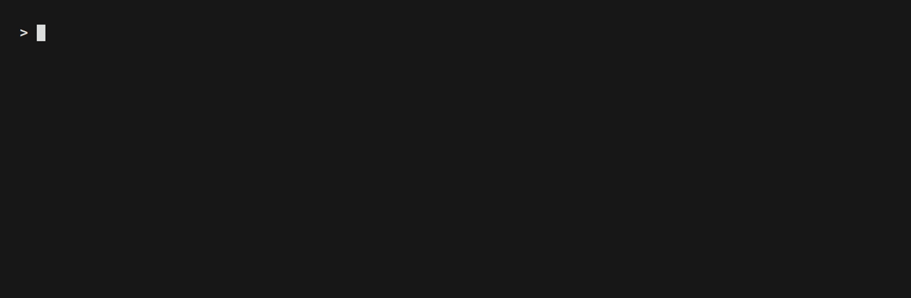

# OCPP Tools

Validate, build, and simulate OCPP 1.6J and 2.0.1 messages in TypeScript: in
the browser, in Node, or in your CI.

[](https://github.com/ocpptools/ocpptools/actions/workflows/ci.yml)
[](https://www.npmjs.com/package/ocpptools)
[](LICENSE)
[](#protocol-coverage)
[](https://nodejs.org/)
[](https://securityscorecards.dev/viewer/?uri=github.com/ocpptools/ocpptools)

[Getting started](docs/getting-started.md) ·
[Documentation](docs/README.md) ·
[Examples](docs/EXAMPLES.md) ·
[Discussions](https://github.com/ocpptools/ocpptools/discussions) ·
[Roadmap](ROADMAP.md)



Also available as [video](docs/assets/cli-demo.mp4). See the validator
[running in the browser](docs/guides/validator-in-the-browser.md).

## What it is

OCPP Tools is a set of small, headless TypeScript packages for the Open Charge
Point Protocol (OCPP-J):

- **Validate** OCPP-J frames and payloads against the official OCPP JSON
  Schemas, with readable errors and JSON Pointers.
- **Simulate** a charging station that connects to your CSMS over WebSocket,
  from Node, from the browser, or from the command line.
- **Build** schema-driven payloads and CALL, CALLRESULT, and CALLERROR frames.
- **Test** OCPP code without sockets, using a mock CSMS, an in-memory transport,
  and a fake clock.

It is for teams that build or test a CSMS, charging station firmware, or OCPP
tooling, and for QA pipelines that need to check OCPP messages automatically.

## Quick start

### Command line

Validate a frame without installing anything:

```sh
echo '[2,"msg-1","Heartbeat",{}]' > frame.json
npx ocpptools validate frame.json --version 2.0.1
```

```text
Valid: frame.json (valid)
```

The commands are for a POSIX shell such as bash or zsh. In Windows PowerShell,
`echo` writes a byte order mark that the CLI rejects as invalid JSON; create the
file with an editor instead. The exit code is `0` for a valid frame and `1` for an invalid one, so the
command works as a CI check. Run a charge point scenario against a CSMS with
`ocpptools simulate`. See the [CLI README](packages/cli/README.md).

### Library

```sh
npm install @ocpptools/validator @ocpptools/schemas
```

```ts
import { readFile, readdir } from 'node:fs/promises';
import { createRequire } from 'node:module';
import { dirname, join } from 'node:path';

import { createSchemaRegistry, createValidator } from '@ocpptools/validator';

const require = createRequire(import.meta.url);
const root = join(dirname(require.resolve('@ocpptools/schemas/package.json')), 'schemas', '2.0.1');

const schemas = createSchemaRegistry({
  version: '2.0.1',
  files: await readdir(root),
  load: async (file) => JSON.parse(await readFile(join(root, file), 'utf8')),
});
const validator = createValidator({ version: '2.0.1', schemas });

const result = await validator.validateFrame('[2,"msg-1","Heartbeat",{}]');
console.log(result.status); // 'valid'
```

For the browser and bundlers, see
[Use the validator in the browser](docs/guides/validator-in-the-browser.md). To connect a
simulated charging station to a CSMS, see the
[simulator README](packages/simulator/README.md).

## Which package do I need?

| I want to…                                           | Package                                                      | npm                                                                                                                          |
| ---------------------------------------------------- | ------------------------------------------------------------ | ---------------------------------------------------------------------------------------------------------------------------- |
| Validate frames from the terminal or CI              | [`ocpptools`](packages/cli/README.md)                        | [](https://www.npmjs.com/package/ocpptools)                             |
| Validate frames and payloads in my code              | [`@ocpptools/validator`](packages/validator/README.md)       | [](https://www.npmjs.com/package/@ocpptools/validator)       |
| Simulate a charging station against my CSMS          | [`@ocpptools/simulator`](packages/simulator/README.md)       | [](https://www.npmjs.com/package/@ocpptools/simulator)       |
| Build payloads and frames, or render a form          | [`@ocpptools/builder`](packages/builder/README.md)           | [](https://www.npmjs.com/package/@ocpptools/builder)           |
| Unit-test OCPP code with a mock CSMS and fake clock  | [`@ocpptools/testing`](packages/testing/README.md)           | [](https://www.npmjs.com/package/@ocpptools/testing)           |
| Parse and serialize frames, and share types          | [`@ocpptools/core`](packages/core/README.md)                 | [](https://www.npmjs.com/package/@ocpptools/core)                 |
| Get the official OCPP JSON Schemas, unmodified       | [`@ocpptools/schemas`](packages/schemas/README.md)           | [](https://www.npmjs.com/package/@ocpptools/schemas)           |
| Normalize JSON Schema drafts and read field metadata | [`@ocpptools/schema-utils`](packages/schema-utils/README.md) | [](https://www.npmjs.com/package/@ocpptools/schema-utils) |

Every package is ESM-only and requires Node.js 22.12 or newer outside the
browser. Every code package ships its own TypeScript types; `@ocpptools/schemas`
contains only data. The engines have no DOM or UI dependency.

## Protocol coverage

| Area         | OCPP 1.6J                          | OCPP 2.0.1                         |
| ------------ | ---------------------------------- | ---------------------------------- |
| JSON Schemas | 56 files, unmodified               | 128 files, unmodified              |
| Validation   | Every action, request and response | Every action, request and response |
| Simulator    | All 28 actions                     | All 64 actions                     |
| CALLERROR    | 1.6J error codes, kept separate    | 2.0.1 error codes, kept separate   |

OCPP 2.1.0 is not supported yet ([ADR 0010](docs/ADR/0010-ocpp-2-1-deferral.md)).
Real X.509 and ISO 15118 cryptography is available as opt-in callbacks; no
crypto implementation is bundled. Nothing in this project is a conformance or
certification tool.

## Examples

Runnable examples live in the `examples/` folder and are tested in CI:

- [Validate a frame](examples/validate-frame/README.md)
- [Simulate a charge point against a mock CSMS](examples/simulate-charge-point/README.md)
- [Build a payload](examples/build-payload/README.md)
- [Use the testing harness](examples/testing-harness/README.md)

See [docs/EXAMPLES.md](docs/EXAMPLES.md) for how to run them or copy them into
your own project.

## Status

All packages are **alpha** (0.x). A minor release may contain breaking changes,
and every breaking change is listed in the package changelog. See the
[compatibility rules](docs/API-INVENTORY.md#compatibility-rules), the
[changelog index](CHANGELOG.md), and the [roadmap](ROADMAP.md).

## Community

- **Questions and ideas:** [GitHub Discussions](https://github.com/ocpptools/ocpptools/discussions).
- **Bugs:** [open an issue](https://github.com/ocpptools/ocpptools/issues/new/choose)
  with a minimal frame or payload.
- **Contributing:** read [CONTRIBUTING.md](CONTRIBUTING.md) and look for
  [`good first issue`](https://github.com/ocpptools/ocpptools/labels/good%20first%20issue).
- **Security:** report vulnerabilities privately, as described in
  [SECURITY.md](SECURITY.md).

Everyone who takes part follows the [Code of Conduct](CODE_OF_CONDUCT.md).

## License

Apache License, Version 2.0, for the code and documentation. See
[LICENSE](LICENSE) and [NOTICE](NOTICE). The Open Charge Alliance's JSON Schemas
are the exception, see below.

### Third-party material

The OCPP JSON Schemas in [`packages/schemas`](packages/schemas/README.md) are not
our work. They are written and published by the
[Open Charge Alliance](https://openchargealliance.org/), which holds the
copyright. They are included as byte-for-byte copies of the originals under the
Creative Commons Attribution-NoDerivatives 4.0 International license
(CC BY-ND 4.0). The Apache License does not apply to them. See
[packages/schemas/SOURCES.md](packages/schemas/SOURCES.md) and
[LICENSES/CC-BY-ND-4.0.txt](LICENSES/CC-BY-ND-4.0.txt).

### Trademark notice

OCPP is a trademark of the Open Charge Alliance (OCA). OCPP Tools is an
independent open-source project and is not affiliated with, endorsed by,
sponsored by, or certified by the Open Charge Alliance. See
[TRADEMARKS.md](TRADEMARKS.md).

To cite this project, use [CITATION.cff](CITATION.cff).
