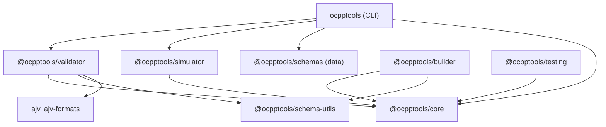

# Architecture

OCPP Tools is a monorepo of small, headless packages. Each package owns one
capability, has a narrow public API, and runs in the browser, in Node, and under
test. This document explains how the packages fit together and the design rules
behind them. The individual decisions are recorded in the
[Architecture Decision Records](ADR/README.md).

## Package graph



| Package                   | Runtime dependencies                         | Role                                                             |
| ------------------------- | -------------------------------------------- | ---------------------------------------------------------------- |
| `@ocpptools/core`         | none                                         | Frame types, parser, serializer, error codes, runtime interfaces |
| `@ocpptools/schema-utils` | none                                         | Pure JSON Schema normalization and field metadata                |
| `@ocpptools/validator`    | `core`, `schema-utils`, `ajv`, `ajv-formats` | Schema validation of frames and payloads                         |
| `@ocpptools/builder`      | `core`, `schema-utils`                       | Schema-driven payload and frame construction                     |
| `@ocpptools/simulator`    | `core`                                       | Charging station protocol engine with browser and Node adapters  |
| `@ocpptools/testing`      | `core`                                       | Test doubles: mock CSMS, in-memory transport, fake clock         |
| `@ocpptools/schemas`      | none                                         | Unmodified OCA JSON Schemas (data only)                          |
| `ocpptools`               | `core`, `schemas`, `simulator`, `validator`  | Command-line wrapper                                             |

The live dependency list and entrypoints are in the
[API inventory](API-INVENTORY.md).

## Design rules

### Headless engines, injected environment

No package touches the DOM, and the protocol engines do not reach for ambient
globals. `@ocpptools/core` defines three interfaces that the caller provides:

- `Transport` and `TransportFactory`: one text connection, usually a WebSocket.
- `Clock`: `now`, `setTimeout`, and `clearTimeout`.
- `Storage`: asynchronous key-value storage for text values.

The simulator ships adapters for the browser (`@ocpptools/simulator/browser`)
and Node (`@ocpptools/simulator/node`) in separate entrypoints, so the engine
itself has no DOM or Node API. The Node entry also provides memory and file
storage. `@ocpptools/testing` provides an in-memory transport and a fake clock
for tests. See [ADR 0006](ADR/0006-simulator-conventions.md) and
[ADR 0007](ADR/0007-simulator-node-adapter.md).

### Schemas are injected, never bundled

The validator and the builder receive their schemas from a registry that the
caller supplies (`{ get(action, kind) }`). They contain no OCPP schema and no
list of actions. This keeps bundles small (only the schemas a consumer imports
are loaded) and keeps the Open Charge Alliance's schemas in a single package
with their license. See [ADR 0003](ADR/0003-oca-json-schemas.md),
[ADR 0005](ADR/0005-validator-conventions.md), and
[ADR 0013](ADR/0013-builder-api.md).

### Results, not exceptions

Expected failures are returned, not thrown:

- The boundary functions of `core`, `schema-utils`, and `builder` return a
  result, `{ ok: true, value }` or `{ ok: false, error }`, with a
  machine-readable code and a path
  ([ADR 0001](ADR/0001-core-api-conventions.md),
  [ADR 0002](ADR/0002-schema-utils-conventions.md)).
- The validator returns a `ValidationResult` with a `status` and a list of
  issues ([ADR 0005](ADR/0005-validator-conventions.md)).
- A simulator scenario returns a `ScenarioResult`; a failed step does not throw
  (see [Scenarios](reference/simulator/scenarios.md)).

### OCPP versions stay separate

OCPP 1.6J and 2.0.1 have different actions, payloads, and CALLERROR codes. The
packages never merge them: error-code sets are per version, the simulator has a
profile per version, and unsupported versions such as OCPP 2.1.0 are rejected
explicitly at the version-aware boundary. See
[ADR 0010](ADR/0010-ocpp-2-1-deferral.md).

### Explicit public API

Each package exports named symbols from explicit entrypoints. No package uses
`export *` at an entrypoint or exposes internals through a wildcard subpath. The
only wildcard subpaths are the data folders of `@ocpptools/schemas`
(`./1.6/*` and `./2.0.1/*`), which expose the schema files by design.
`pnpm check:api-inventory` catches packaging drift.

### Security by injection

Real cryptography (X.509 chain validation, revocation, CSR generation, firmware
verification, ISO 15118 EXI) is opt-in through callbacks. The engine bundles no
crypto library and never stores private keys. See
[ADR 0009](ADR/0009-real-crypto-15118.md),
[ADR 0011](ADR/0011-no-reference-crypto-adapter.md),
[ADR 0012](ADR/0012-security-callback-model.md), and the
[threat model](security/crypto-15118.md).

## Repository layout

```text
packages/        published packages (one folder each)
examples/        runnable examples, tested in CI, not published
docs/            documentation, ADRs, and maintainer runbooks
scripts/         repository checks used by `pnpm verify`
.changeset/      pending release notes
.github/         workflows, issue and pull request templates
```

## Quality gates

`pnpm verify` runs the CI checks, except the production dependency audit and the
browser end-to-end tests: lint, format, type checks, tests with
coverage thresholds, build, runnable examples, bundle checks, package lint
(`publint`, `attw`), a packed-tarball install test, size limits, API inventory,
workflow pins, the OCA schema guard, and REUSE license compliance. See
[CONTRIBUTING.md](../CONTRIBUTING.md#check-your-change).
