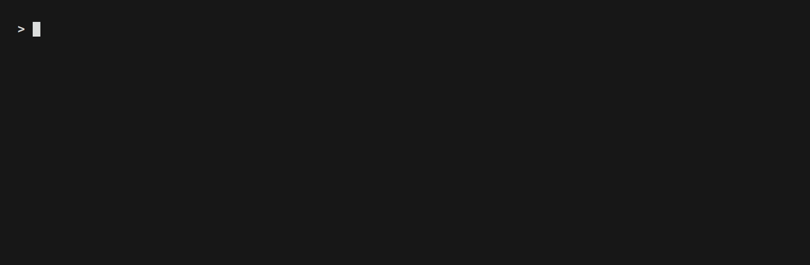
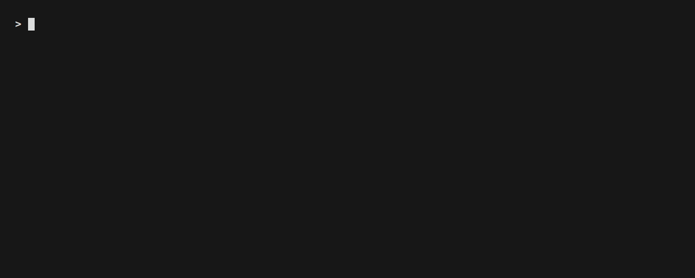

# Run a simulated charge point against your CSMS

The simulator acts as an OCPP charging station that connects to your CSMS over
WebSocket. Use it to test a CSMS without hardware. You can drive it from the
command line with a JSON scenario, or from code.

Requirements: Node.js 22.12 or newer, and a CSMS WebSocket endpoint that speaks
OCPP 1.6J or 2.0.1, for example `ws://127.0.0.1:9000/CP001`.

## From the command line

### 1. Describe the charging station

Create `charge-point.json`. This is the minimum for OCPP 2.0.1:

```json
{
  "version": "2.0.1",
  "url": "ws://127.0.0.1:9000/CP001",
  "station": {
    "id": "CP001",
    "vendorName": "Acme",
    "model": "AC-22",
    "firmwareVersion": "2.0.0",
    "evseCount": 1,
    "defaultIdToken": "AABBCCDD"
  }
}
```

For OCPP 1.6J, the station uses the 1.6 field names:

```json
{
  "version": "1.6",
  "url": "ws://127.0.0.1:9000/CP001",
  "station": {
    "id": "CP001",
    "vendor": "Acme",
    "model": "AC-7",
    "firmwareVersion": "1.0.0",
    "connectorCount": 1,
    "defaultIdTag": "AABBCCDD"
  }
}
```

### 2. Write a scenario

Create `run.json`. Steps run in order:

```json
[
  { "type": "boot" },
  { "type": "authorize", "idToken": "AABBCCDD" },
  { "type": "start", "idToken": "AABBCCDD" },
  { "type": "meter" },
  { "type": "stop", "reason": "Local" }
]
```

### 3. Run it

```sh
npx ocpptools simulate --config charge-point.json --scenario run.json
```

The CLI connects, runs the steps, disconnects, and prints every step with its
status. A failed step ends the scenario with its error code. Add `--json` to get
the `ScenarioResult` as JSON.



The last command of the recording runs this scenario. Also available as
[video](../assets/cli-demo.mp4).

| Exit code | Meaning                                                                       |
| --------- | ----------------------------------------------------------------------------- |
| `0`       | The scenario completed.                                                       |
| `2`       | A config or scenario file is missing, invalid JSON, or has an invalid shape.  |
| `3`       | Connection failure, or the scenario failed or was cancelled without a signal. |
| `130`     | Cancelled by `SIGINT`.                                                        |
| `143`     | Cancelled by `SIGTERM`.                                                       |

Every config section (boot, timing, reconnection, fault injection, outbound
validation, persistence) and every step type is described in the
[CLI reference](../reference/cli.md).

### Useful options

- **Check what you send.** Set `"validation": { "mode": "block" }` to validate
  every outbound CALL against the official schemas before it is sent.
- **Test error handling.** `"faults": { "latencyMs": 500, "dropRate": 0.1 }`
  delays and drops outbound frames.
- **Keep state between runs.** `"storage": { "directory": ".cache/ocpptools-state" }`
  saves the station state after each run and loads it before the next.

## From code

Use the simulator directly when you need events, custom flows, or many stations:

```sh
npm install @ocpptools/simulator @ocpptools/core
```

```ts
import { createNodeWebSocketTransportFactory, nodeClock } from '@ocpptools/simulator/node';
import { Simulator201 } from '@ocpptools/simulator/2.0.1';

const simulator = new Simulator201({
  url: 'ws://127.0.0.1:9000/CP001',
  transport: createNodeWebSocketTransportFactory(),
  clock: nodeClock,
  station: {
    id: 'CP001',
    vendorName: 'Acme',
    model: 'AC-22',
    firmwareVersion: '2.0.0',
  },
});

simulator.on('connection', (event) => console.log('connection', event));
simulator.on('error', (event) => console.error(event.error.code, event.error.message));

simulator.connect();
```

Run the same steps as the CLI scenario with `simulator.runScenario([...])`. Wait
for the `connection` event with the state `connected` first: a step fails with
`not-connected` while the transport is not open.



Also available as [video](../assets/simulator-code.mp4). The recorded script,
[`station.mjs`](../../scripts/demos/terminal/fixtures/station.mjs), runs against
a synthetic CSMS.

See the [simulator reference](../reference/simulator/README.md) for
transactions, the device model, security callbacks, persistence, and lab
controls.

## Limits

- The Node transport sets only the URL and the OCPP subprotocol. Custom headers,
  such as HTTP Basic authentication for security profile 1, and mutual TLS need
  a wrapper around the injected `WebSocket` constructor. See the
  [simulator limits](../../packages/simulator/README.md#limits).
- The simulator is not a conformance tool. A passing scenario does not certify
  your CSMS.
