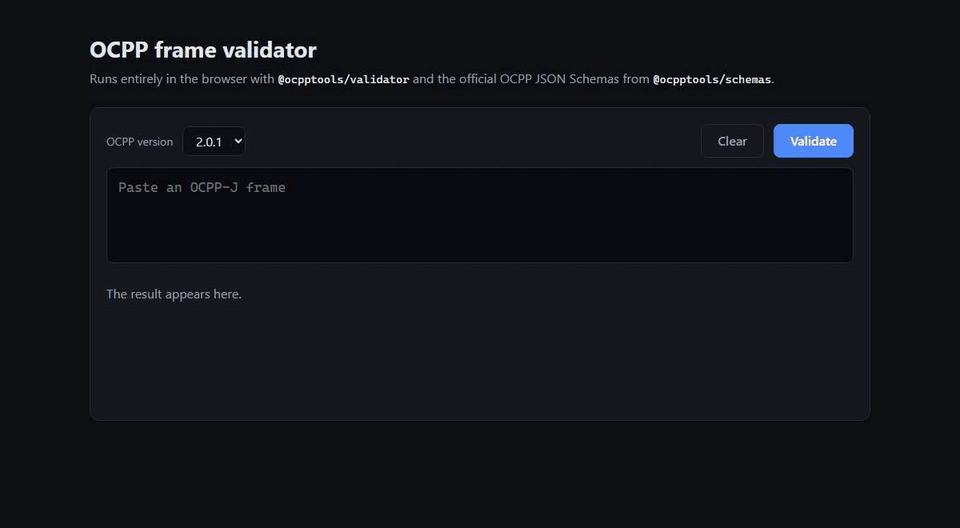

# Use the validator in the browser or with a bundler

`@ocpptools/validator` has no DOM or Node APIs, so it runs in the browser. It
does not bundle the OCPP JSON Schemas: your code tells the bundler which schema
files to load, and each file is fetched only when an action is first validated.



Also available as [video](../assets/browser-validator.mp4). The page is a
minimal demo built with the published `@ocpptools/validator` and
`@ocpptools/schemas` packages; it loads each schema file with `fetch` when it is
first needed.

## Vite and Astro

A bundler only splits imports it can see in your code. Use `import.meta.glob`
and build the list of files from its keys:

```ts
import { createSchemaRegistry, createValidator } from '@ocpptools/validator';

const modules = import.meta.glob('/node_modules/@ocpptools/schemas/schemas/2.0.1/*.json', {
  import: 'default',
});
const files = Object.keys(modules).map((path) => path.split('/').pop()!);

const schemas = createSchemaRegistry({
  version: '2.0.1',
  files,
  load: (fileName) => modules[`/node_modules/@ocpptools/schemas/schemas/2.0.1/${fileName}`](),
});

const validator = createValidator({ version: '2.0.1', schemas });
```

A template literal such as ``import(`@ocpptools/schemas/2.0.1/${name}.json`)`` is
not split by Vite. Use `import.meta.glob` or a written map of `import()` calls.

## Other bundlers

Any bundler works if the loader uses static import paths. A written map is the
portable form:

```ts
const loaders: Record<string, () => Promise<unknown>> = {
  'HeartbeatRequest.json': () =>
    import('@ocpptools/schemas/2.0.1/HeartbeatRequest.json', { with: { type: 'json' } }).then(
      (module) => module.default,
    ),
  // one entry per schema you need
};

const schemas = createSchemaRegistry({
  version: '2.0.1',
  files: Object.keys(loaders),
  load: (fileName) => loaders[fileName]?.(),
});
```

List only the actions your application handles to keep the bundle small.

## Content Security Policy

Ajv compiles schemas with `new Function`. A Content Security Policy without
`unsafe-eval` blocks the validator. Precompiled validators are a possible future
improvement. Until then, allow `unsafe-eval` on the pages that validate, or
validate on the server. A web worker is subject to a Content Security Policy
too, so it only helps if it is served with a policy that allows `unsafe-eval`.

## Number precision

The validator uses `multipleOfPrecision: 6`, so decimal values such as `0.3`
against `multipleOf: 0.1` are valid. Validators without a precision setting can
reject them because of floating-point error, so results may differ from other
JSON Schema tools.

The `import.meta.glob` pattern above is not covered by the repository tests.
If your package manager places `@ocpptools/schemas` elsewhere, adjust the path.
