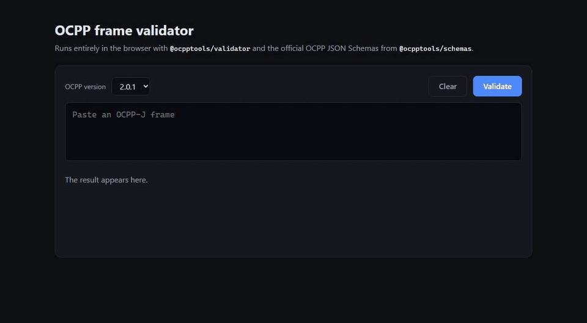

# @ocpptools/validator

Validation of OCPP-J frames and payloads against the OCPP JSON Schemas, with readable errors.

[](https://www.npmjs.com/package/@ocpptools/validator)
[](https://github.com/ocpptools/ocpptools/blob/main/LICENSE)

> **Status:** alpha. The API can change in any minor release before 1.0.0.



It uses Ajv and `ajv-formats`, receives its schemas from a registry you provide,
and compiles each schema lazily. It contains no OCPP schema and no list of
actions. It has no DOM or Node APIs. It is tested against all 184 OCPP 1.6J and
2.0.1 schemas.

## When to use it

- You need to check OCPP 1.6J or 2.0.1 frames and payloads in your own code: in
  a CSMS, a charging station, a gateway, a test suite, or a browser tool.
- You want errors with a JSON Pointer, a code, and the expected and received
  values.
- To validate files from the terminal or CI without writing code, use the
  [`ocpptools` CLI](https://github.com/ocpptools/ocpptools/tree/main/packages/cli).
- To only parse frames without schemas, use
  [`@ocpptools/core`](https://github.com/ocpptools/ocpptools/tree/main/packages/core).

## Install

```sh
npm install @ocpptools/validator @ocpptools/schemas
```

Requires Node.js 22.12 or newer outside the browser. The package is ESM-only.
`@ocpptools/schemas` is optional: any registry that returns JSON Schemas works.

## Quick start

In Node, load the official schemas from `@ocpptools/schemas`:

```ts
import { readFile, readdir } from 'node:fs/promises';
import { createRequire } from 'node:module';
import { dirname, join } from 'node:path';

import { createSchemaRegistry, createValidator } from '@ocpptools/validator';

const require = createRequire(import.meta.url);
const root = join(dirname(require.resolve('@ocpptools/schemas/package.json')), 'schemas', '2.0.1');

const schemas = createSchemaRegistry({
  version: '2.0.1',
  files: await readdir(root),
  load: async (file) => JSON.parse(await readFile(join(root, file), 'utf8')),
});
const validator = createValidator({ version: '2.0.1', schemas });

const result = await validator.validateFrame([2, 'id-1', 'Heartbeat', {}]);

if (result.status !== 'valid') {
  console.log(result.status, result.issues, result.warnings);
}
```

For Vite, Astro, and other bundlers, see
[Use the validator in the browser](https://github.com/ocpptools/ocpptools/blob/main/docs/guides/validator-in-the-browser.md).

Only OCPP 1.6J and 2.0.1 are supported. `createValidator` and
`createSchemaRegistry` throw a clear `Unsupported OCPP version` error for
anything else, including OCPP 2.1.0, before loading a schema. `schemaFileName`
returns `undefined` for an unsupported version.

## Load one schema file

To load only the schemas you use, import each file. `files` accepts a name with
or without the version folder:

```ts
const schemas = createSchemaRegistry({
  version: '2.0.1',
  files: ['2.0.1/HeartbeatRequest.json'],
  load: async (fileName) => {
    if (fileName !== 'HeartbeatRequest.json') return undefined;
    const module = await import('@ocpptools/schemas/2.0.1/HeartbeatRequest.json', {
      with: { type: 'json' },
    });
    return module.default;
  },
});
```

## Validate a frame

A string is parsed as JSON text. Any other value is treated as an already parsed
frame:

```ts
await validator.validateFrame('[2,"id-1","Heartbeat",{}]');
await validator.validateFrame([2, 'id-1', 'Heartbeat', {}]);
```

## Validate a payload

If you already know the action and kind, skip the frame:

```ts
const result = await validator.validatePayload('Heartbeat', 'request', {});
```

`validatePayload` returns paths relative to the payload. `validateFrame` returns
paths relative to the frame: `[3, 'idTag']` for a CALL and `[2, 'status']` for a
CALLRESULT.

## Validate a CALLRESULT

A CALLRESULT does not name its action. Pass the request action to check its
payload; otherwise the frame is valid with an `unchecked-result` warning:

```ts
await validator.validateFrame([3, 'id-1', { currentTime: '2026-01-01T00:00:00Z' }], {
  requestAction: 'Heartbeat',
});
```

## Results

`status` is one of:

| Status            | Meaning                                                          |
| ----------------- | ---------------------------------------------------------------- |
| `valid`           | The frame is valid and every checked payload matches its schema. |
| `invalid-frame`   | The text is not JSON, or the frame structure is invalid.         |
| `unknown-action`  | The registry has no schema for the action and kind.              |
| `schema-missing`  | The action is known, but its schema could not be loaded or used. |
| `invalid-payload` | The payload does not match the schema.                           |

An issue has `code`, `path`, `pointer`, `message`, and, when applicable,
`keyword`, `expected`, and `received`. Payload issues are sorted by path and
keyword. Warnings do not invalidate the result; a long message ID and an
unchecked CALLRESULT are warnings.

## Bring your own schemas

The package does not need `@ocpptools/schemas`. A registry only has to answer
`get(action, kind)`:

```ts
const schemas = {
  get(action: string, kind: 'request' | 'response') {
    if (action !== 'Heartbeat') return undefined;
    return kind === 'request'
      ? { type: 'object', properties: {}, additionalProperties: false }
      : {
          type: 'object',
          required: ['currentTime'],
          properties: { currentTime: { type: 'string' } },
        };
  },
};
```

Each schema must be self-contained: a `$ref` to another supplied schema by
`$id` is not supported. A real module namespace, which is what `import()`
returns, is rejected; return the schema or its `.default` export.

## API

- `createValidator({ version, schemas })`
- `Validator.version`, `validateFrame(input, options?)`, `validatePayload(action, kind, payload)`
- `createSchemaRegistry({ version, load, files? })`
- `SchemaRegistry`, `SchemaRegistryOptions`, `SchemaLoadError`
- `schemaFileName(version, action, kind)`
- `ValidationResult`, `ValidationIssue`, `ValidationIssueCode`

The conventions the package follows are in
[ADR 0005](https://github.com/ocpptools/ocpptools/blob/main/docs/ADR/0005-validator-conventions.md).

## Limits

- Ajv compiles schemas with `new Function`, so a Content Security Policy
  without `unsafe-eval` blocks the validator. Precompiled validators are a
  possible future improvement.
- `multipleOfPrecision` is 6, so decimal values such as `0.3` against
  `multipleOf: 0.1` are valid.
- `received` is truncated to 40 characters.
- There is no limit on the number of issues.
- A schema must be self-contained; cross-schema `$ref` by `$id` is not supported.
- A schema that uses `__proto__` as a property name is rejected.
- Validation does not coerce types or insert defaults.

## Related packages

- [`@ocpptools/schemas`](https://github.com/ocpptools/ocpptools/tree/main/packages/schemas):
  the official OCPP JSON Schemas, unmodified.
- [`ocpptools`](https://github.com/ocpptools/ocpptools/tree/main/packages/cli):
  this validator on the command line.
- [`@ocpptools/builder`](https://github.com/ocpptools/ocpptools/tree/main/packages/builder):
  builds payloads from the same registry shape.
- [`@ocpptools/simulator`](https://github.com/ocpptools/ocpptools/tree/main/packages/simulator):
  can check every outbound call with a validation callback, for example one
  backed by this validator.

## License

Apache-2.0. See the repository `LICENSE` and `NOTICE`.

OCPP is a specification of the Open Charge Alliance. This project is not
affiliated with, endorsed by, or certified by the Open Charge Alliance.
